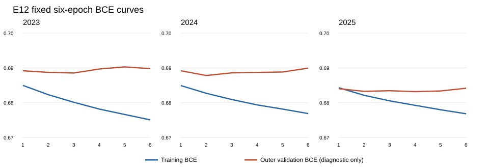
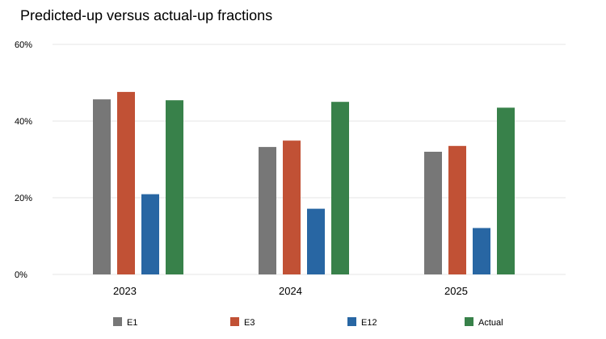

# E12: 20-session LSTM sequence experiment

## Decision

**Retain E3 as the reference.** E12's exploratory equal-year mean official score is slightly higher, but it loses to E3 in 2023, its paired uncertainty interval includes zero in every year, and its daily lower tail is worse in all three years. The LSTM also predicts *up* substantially less often than E3. These reused validation years do not establish that the LSTM generalizes better or that it learned useful sequence information beyond F0.

## Fixed design and evaluation

E12 uses the unchanged shared F0 definitions and 2023, 2024, and 2025 expanding-window folds. For each stock and prediction date, it takes 20 consecutive **stock trading-session** F0 snapshots ending on that date. Each snapshot was constructed under the shared pre-09:00 availability rules; prior validation-year snapshots can supply history without providing validation labels to training. The 19 numeric F0 fields form the sequence. Prediction-day stock ID and weekday are training-fitted one-hot context. Each fold fits the shared median imputation and numeric scaling on its training rows only, then freezes that preprocessing for validation.

The fixed model is one LSTM layer with 32 hidden units and a prediction head with 0.2 dropout. Training uses binary cross-entropy, Adam at 0.001, batch size 1,024, seed 42, gradient clipping at 1.0, and exactly six epochs on CPU. The decision threshold is 0.5. No architecture, epoch, or threshold was selected using the outer evaluation year. Outer-year BCE recorded during training is **diagnostic only**; the sixth epoch is always evaluated. A first 20-snapshot window is required, so early training rows without enough same-stock history are excluded. Every target-stock validation row has a complete sequence.

E1 and E3 are reconstructed from the archived E1 out-of-sample probabilities and frozen E3 TAIEX rule. Their scores reproduce the archived controls. All three approaches are evaluated on identical stock-date keys (11,950 in 2023; 12,099 in 2024; 12,140 in 2025) using the shared official scorer. The experiment did not access Phase 1, the inspected 2026 holdout, or October outcomes for configuration selection.

## Official validation results

| Evaluation year | E1 score | E3 score | E12 score | E12 − E3 | E12 accuracy | E12 predicted up |
| --- | ---: | ---: | ---: | ---: | ---: | ---: |
| 2023 | 0.000634 | 0.000611 | 0.000211 | −0.000400 | 53.77% | 20.93% |
| 2024 | 0.000211 | 0.000391 | 0.000704 | +0.000313 | 54.84% | 17.13% |
| 2025 | 0.000900 | 0.000919 | 0.001050 | +0.000131 | 56.00% | 12.11% |
| Equal-year mean | 0.000581 | 0.000640 | 0.000655 | +0.000015 | — | — |

E1 accuracy was 51.92%, 52.65%, and 53.88%; E3 accuracy was 52.08%, 52.65%, and 53.88% in 2023–2025. E12 gains directional accuracy in each year, yet its 2023 return-weighted score is much worse. Thus accuracy alone does not explain the official score.

## Probability balance and daily stability

| Year | Actual up | E3 predicted up | E12 predicted up | E12 mean probability | E12 median probability | E12 probability p10–p90 |
| --- | ---: | ---: | ---: | ---: | ---: | ---: |
| 2023 | 45.42% | 47.60% | 20.93% | 0.4566 | 0.4568 | 0.3877–0.5259 |
| 2024 | 45.00% | 34.90% | 17.13% | 0.4459 | 0.4435 | 0.3751–0.5201 |
| 2025 | 43.48% | 33.51% | 12.11% | 0.4356 | 0.4323 | 0.3677–0.5073 |

E12 is more bearish than E3 in every fold. Actual up rates decline modestly, while E12 predicted-up rates decline much more. The three folds use **different fitted LSTMs**, so these cross-year numbers cannot be interpreted as drift of one frozen model.

| Year | E3 negative days | E12 negative days | E3 daily score p10 | E12 daily score p10 | Paired E12 − E3 95% interval |
| --- | ---: | ---: | ---: | ---: | ---: |
| 2023 (239 days) | 104 | 115 | −0.003931 | −0.005102 | [−0.001019, +0.000224] |
| 2024 (242 days) | 113 | 100 | −0.005047 | −0.005979 | [−0.000281, +0.000911] |
| 2025 (243 days) | 112 | 116 | −0.004811 | −0.006244 | [−0.000422, +0.000725] |

The equal-year paired interval for E12 − E3 is [−0.000324, +0.000363]. Intervals come from 3,000 paired circular bootstrap draws of five consecutive trading days within each year (seed 42); stocks on the same day remain grouped. They describe uncertainty within these previously reused years, not an independent generalization test. Daily median, tails, and full paired scores are in the saved CSV files.





Training BCE falls through epoch six in all folds. Outer-year BCE is lowest at epoch three for 2023, epoch two for 2024, and epoch four for 2025, then rises by epoch six. This is a warning sign for later-epoch fitting, but the outer year was not used to choose an epoch; selecting those minima would leak evaluation information into the procedure. A future early-stopping design would need an **inner chronological** split fixed before outer evaluation.

## Runtime and interpretation

Sequence construction took 3.0–3.7 seconds per fold; six-epoch training plus diagnostic curves took 32.5–45.0 seconds; final validation inference took 0.06–0.10 seconds. These are observed CPU runtimes on this machine, not portable benchmarks.

E12 changes both the model class and how the 19 numeric F0 values are presented. Therefore the E12–E3 comparison cannot isolate the value of sequence memory; there is no within-LSTM sequence ablation. The score advantage is only +0.000015 on the equal-year mean, with inconsistent yearly effects, wider bad-day tails, and a more pronounced bearish decision pattern. The evidence does not justify replacing E3 or preparing an E12 submission. It also does not prove that all sequence models are ineffective.

The shared F0 publication-time and supplied-indicator reproducibility assumptions remain as previously documented; this experiment does not externally verify them.

## Reproduction and saved evidence

From `final_project`:

```powershell
uv run --extra e12 python -m unittest tests.test_zhenci_e12
uv run --extra e12 python -m members.zhenci.e12.train_e12 --output-dir members/zhenci/e12/reproduction
uv run --extra e12 python -m members.zhenci.e12.plot_e12 --output-dir members/zhenci/e12/outputs
```

The training command refuses to overwrite an existing output directory. Existing results are in `outputs/`: fold and daily metrics, every paired out-of-sample prediction, probabilities, learning curves, runtime, uncertainty estimates, three model state files, three fitted-preprocessor states, and input hashes and package versions in `summary.json`. The plot command reads only saved CSV files and does not retrain. PyTorch is an optional `e12` dependency in `pyproject.toml`.
