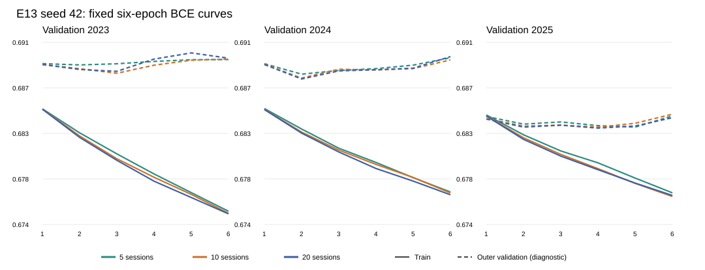

# E13: LSTM sequence-length comparison

## Decision

**Retain the original E12 20-session LSTM configuration for this LSTM line of work.** Shortening the sequence to 10 sessions did not improve the equal-year official score when the same three seeds were compared. The 5-session window did worse in the initial seed-42 comparison. This does **not** establish E12 as a replacement for E3: its advantage over E3 on these repeatedly inspected historical folds remains small and unconfirmed on unused data. E3 remains the project reference.

## Controlled design

E13 uses the existing E12 implementation and its archived 20-session, seed-42 predictions as the control. The initial comparison changes only the sequence length: 5, 10, or 20 stock trading-session F0 snapshots, ending with the prediction-date snapshot. For the 5- and 10-session variants, the runner takes the **last** 5 or 10 snapshots from each original E12 20-session sample. This deliberately keeps the **training and validation stock-date keys identical** across windows; every arm has the same 20-session warm-up exclusion. Validation has 11,950 keys in 2023, 12,099 in 2024, and 12,140 in 2025. No calendar-day padding, future snapshots, target-day completed prices, or target labels enter the inputs. Each snapshot uses shared F0's pre-09:00 availability rules.

The 19 numerical F0 fields are the sequence inputs. Stock ID and prediction-day weekday remain training-fitted categorical context. For each expanding-window fold, the shared median imputation and scaling are fitted only to that fold's training data. E13 keeps E12's one-layer LSTM, 32 hidden units, 0.2 head dropout, binary cross-entropy, Adam at 0.001, batch size 1,024, gradient clipping at 1.0, six fixed epochs, and 0.5 decision threshold. Outer-year validation loss is recorded for diagnosis, never used to choose an epoch. The folds are train 2020–2022/validate 2023, train 2020–2023/validate 2024, and train 2020–2024/validate 2025.

The best **shorter** candidate was selected by its seed-42 equal-year mean on these historical folds. That was 10 sessions. We then ran both 10 and 20 sessions with seeds 42, 43, and 44; seed 42 of the 20-session arm is the unchanged archived E12 result. No seed was selected as a final model. E3 uses the archived predictions on the same keys. The official score is the shared return-weighted scorer, not accuracy. Phase 1, the previously inspected 2026 holdout, and October results were excluded from configuration selection.

## Initial sequence-length comparison: seed 42

| Sessions | 2023 score | 2024 score | 2025 score | Equal-year mean | Accuracy 2023 / 2024 / 2025 |
| ---: | ---: | ---: | ---: | ---: | --- |
| 5 | 0.000061 | 0.000322 | 0.001062 | 0.000482 | 54.09% / 54.64% / 56.17% |
| 10 | 0.000229 | 0.000560 | 0.000927 | 0.000572 | 53.96% / 54.79% / 56.03% |
| 20, original E12 | 0.000211 | 0.000704 | 0.001050 | 0.000655 | 53.77% / 54.84% / 56.00% |
| E3 reference | 0.000611 | 0.000391 | 0.000919 | 0.000640 | 52.08% / 52.65% / 53.88% |

At seed 42, 10 sessions slightly beats 20 in 2023 (+0.000018) but loses in 2024 (−0.000144) and 2025 (−0.000124). Five sessions has the lowest equal-year score. The 20-session score exceeds E3's equal-year score by only 0.000015, as reported in E12.

## Seed robustness: 10 versus 20 sessions

| Sessions | Seed | 2023 score | 2024 score | 2025 score | Equal-year mean |
| ---: | ---: | ---: | ---: | ---: | ---: |
| 10 | 42 | 0.000229 | 0.000560 | 0.000927 | 0.000572 |
| 20 | 42 | 0.000211 | 0.000704 | 0.001050 | 0.000655 |
| 10 | 43 | 0.000301 | 0.000728 | 0.001179 | 0.000736 |
| 20 | 43 | 0.000292 | 0.000721 | 0.001259 | 0.000757 |
| 10 | 44 | 0.000406 | 0.000545 | 0.001022 | 0.000658 |
| 20 | 44 | 0.000367 | 0.000681 | 0.000995 | 0.000681 |

Across seeds, the mean equal-year score is **0.000655 for 10** and **0.000698 for 20**, a paired 10-minus-20 difference of **−0.000043**. The respective sample standard deviations across the three seed-level means are 0.000082 and 0.000053. The 20-session configuration scores higher at each matched seed, although the per-seed gaps are small. The 10-session model wins 2023 at all three seeds; 20 wins 2024 at two seeds and 2025 at two seeds. Three seeds and three repeatedly inspected years do not give a precise estimate of performance on a new period.

## Predictions, daily scores, and training behavior

| Year | Actual up | 5-session up / mean probability | 10-session up / mean probability | 20-session up / mean probability | 10-session probability p10–p90 | 20-session probability p10–p90 |
| --- | ---: | ---: | ---: | ---: | ---: | ---: |
| 2023 | 45.42% | 12.05% / 0.4472 | 19.98% / 0.4582 | 20.93% / 0.4566 | 0.3940–0.5211 | 0.3877–0.5259 |
| 2024 | 45.00% | 13.13% / 0.4450 | 14.60% / 0.4434 | 17.13% / 0.4459 | 0.3741–0.5136 | 0.3751–0.5201 |
| 2025 | 43.48% | 10.97% / 0.4353 | 12.31% / 0.4362 | 12.11% / 0.4356 | 0.3684–0.5080 | 0.3677–0.5073 |

These are **seed-42** distributions. All LSTM variants predict up much less often than the observed up fraction. Shortening the sequence does not resolve the bearish decision pattern. Each validation year uses a different fitted model, so the cross-year pattern is not drift measured on a single frozen model. Full probability quantiles, accuracies, and seed-specific predicted-up rates are saved in `outputs/probability_summary.csv` and `outputs/fold_metrics.csv`.

| Year | 10-session negative days | 20-session negative days | 10-session daily score p10 | 20-session daily score p10 |
| --- | ---: | ---: | ---: | ---: |
| 2023, 239 days | 110 | 115 | −0.005230 | −0.005102 |
| 2024, 242 days | 105 | 100 | −0.006283 | −0.005979 |
| 2025, 243 days | 114 | 116 | −0.006222 | −0.006244 |

These daily figures are for seed 42. Both arms use the same stock-date keys, and stocks on the same day are treated as a group in the saved daily tables. The 10-session variant has a slightly worse lower tail in 2023 and 2024, with a marginally better tail in 2025. Full daily scores for all three seeds are in `outputs/daily_scores.csv`.



Training BCE declines through the sixth epoch for all nine initial fits. Outer-validation BCE reaches its minimum at epoch 2–5, then ends above that minimum in every case. For example, the seed-42 2024 10-session curve moves from 0.68790 at epoch 2 to 0.68961 at epoch 6. That is a warning about later-epoch fit, but changing the stopping point using the outer validation year would violate the protocol. Median-based preprocessing and model parameters are fixed within each fold. The new 5- and 10-session seed-42 runs took approximately 10.4 and 13.7 seconds per fold for training plus curve calculation on this CPU; E12's archived control has its own recorded runtime.

## Interpretation and reproducibility

The controlled ablation gives no evidence that shorter input history improves this LSTM's return-weighted validation performance. The 10-session variant's small 2023 benefit does not carry consistently to 2024–2025, and its three-seed mean trails 20 sessions. Keep E12's 20-session recipe if continuing LSTM work, and keep E3 as the broader reference until a genuinely unused evaluation supports a change. This experiment neither tunes epochs nor tests a different architecture.

From `final_project`, the following commands reproduce the experiment. Completed, hash-verified run folders are reused when resuming between folds:

```powershell
uv run --extra e12 python -m members.zhenci.lstm.e13.train_e13 --stage initial
uv run --extra e12 python -m members.zhenci.lstm.e13.train_e13 --stage robustness
uv run --extra e12 python -m members.zhenci.lstm.e13.plot_e13
```

For a separate fresh output, pass `--output-dir members/zhenci/lstm/e13/reproduction` to both training commands and to the plot command. The runner checks the original F0 and archived E12 hashes, verifies identical stock-date keys and reproduced E12/E3 scores, and saves each new model, predictions, losses, metrics, input hashes, package versions, daily scores, and seed summaries under `outputs/`. A fixed synthetic-input parity check showed the E13 seed-42, 20-session training loop gives exactly the same predictions and BCE curves as E12's loop. The shared F0 publication-timing and supplied technical-indicator reproducibility assumptions remain unverified as documented elsewhere; E13 does not alter them.
