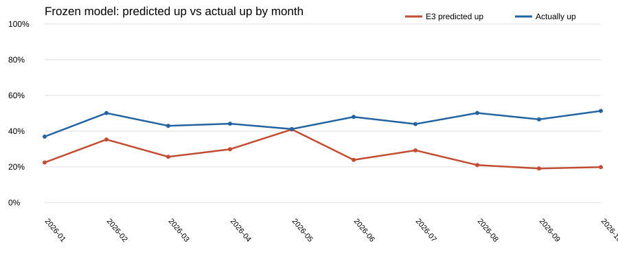

# Final XGBoost research synthesis: E1–E21

## Decision

**Retain static E3 as the individual XGBoost model and close the optimization track.** E3 couples the original F0 classifier with a fixed rule based on prior TAIEX returns. It has a reproducible **0.00064050** mean official score on the three full-year validation folds, and the alternatives that exceeded it on those folds did so without a reliable advantage on later or less favorable periods. The best documented personal Phase 1 result is **+0.000051 for E16-A**, as reported by the user. E16-A’s historical mean was **0.00053358**. The two decisions answer different questions: which fixed model has the best support across our historical evidence, and which documented submission scored highest in the examined competition window.

E19 established a consistent probability overfitting pattern in the saved models. E20 reduced that pattern and made official performance worse. E21 showed that adding January–May training observations can improve within-day rankings and still lower the overall score. Across the track, better classification loss or stock ordering was repeatedly insufficient to improve return-weighted decisions.

## Evidence and evaluation protocols

This synthesis uses saved configurations, metric tables, fitted model and preprocessing artifacts, and archived predictions. The [machine-readable catalogue](XGBOOST_EXPERIMENT_SUMMARY.csv) records the configuration, scope, evidence path and locator for every row. Historical means weight years equally. E1 and early studies retain their recorded seed aggregation, and later experiments use their specified reference seeds. The full-year validation target counts are 11,950, 12,099, and 12,140 in 2023–2025. E14 excludes 11 incomplete cross-sections for every arm. E16 keeps them, with 24 up and 25 down calls when a ranked date has 49 stocks. E21 evaluates only June–September in each year. These protocol differences affect even the E3 control score.

The January–May 2026 holdout and October 1–22 replay are separate, already-inspected periods. Phase 1 covers all 4,200 supplied template keys in June–September 2026. The local E1/E3 replay uses supplied adjusted returns and matches the user-reported results to six decimal places. Competition-server scoring rows and receipts were unavailable. Other existing Phase 1 files were checked for template shape, stock order and binary values, but a file establishes preparation only. The only dated Phase 2 prediction artifact located for this track is E3’s November 18 file. It replays exactly and contains 50 decisions, including nine up calls. No corresponding independently scored result or upload receipt was located. [E1/E3 replay](../diagnostics/e1_e3_gap_report.md), [November 18 predictions](../../../../submissions/zhenci_e3_taiex_2026-11-18.csv).

The E3 synthesis uses the `v2` decision study. The `v1` fixed-threshold controls substituted 0.5 when TAIEX was missing, which makes those control rows incomparable with a genuinely constant cutoff. The winning TAIEX rule is unchanged between those versions. An earlier proposed-state workspace overview also predates the completed E4 and later results. The catalogue records completion from saved outputs. [E3 comparison notes](../../README.md), [corrected threshold archive](../../../../results/zhenci_xgboost_e3_market_regime_v2/summary.json).

## Experiment catalogue

Full-year scores are equal-year historical means unless the cell says otherwise. A dash means no verified numeric result for that evaluation. E1/E3 Phase 1 numbers are verified **local replays**. E16-A’s Phase 1 number is **user-reported**.

| Experiment | Research hypothesis | Methodological change | Control model | Historical official score | Phase 1 score | Conclusion |
| --- | --- | --- | --- | --- | --- | --- |
| E1 | Establish a common baseline | Full-sample F0 XGBoost versus row/column sampling, cutoff 0.5 | Full-sample E1 | Full 0.00058145, sampled 0.00044715 | −0.00031791, full | Keep the full-sample probability model. [Archive](../../../../results/zheng_xgboost_e1_five_seeds_v1/summary.json) |
| E2 | Tune capacity or improve label/feature alignment | Four-arm grid, F1, absolute-return weights, direct return regression | Full E1 or matched classifier | Best grid 0.00050899, F1 0.00052164, weighted 0.00041409, regression 0.00028540 | — | F1 beat its tuned F0 control of 0.00050899. The other changes did not beat their relevant controls. [Variants](XGBOOST_EXPERIMENT_SUMMARY.csv) |
| E3 | Better model settings or TAIEX-conditioned decisions | Optuna, stock universe/recency, relative inputs, DART, fixed and market-conditioned cutoffs | Full E1 | TAIEX 0.00064050, walk-forward rule selection 0.00061478 | −0.00006194 | The original trees remained the strongest model in the searches. Adopt the frozen TAIEX decision rule as the historical reference. [Rule archive](../../../../results/zhenci_xgboost_e3_market_regime_v2/summary.json) |
| E4 | Separate intraday and overnight history helps | F2 lagged rolling means and spread | F0 with same rule | 0.00045231 with TAIEX | — | Below matched F0. [Archive](../../../../results/zhenci_xgboost_e4_f2_v1/summary.json) |
| E5 | Removing weak F0 features helps | Seven prespecified ablations | Full F0 | Best TAIEX ablation 0.00051820 | — | Full F0 won. [Archive](../../../../results/zhenci_xgboost_e5_f0_ablation_v1/summary.json) |
| E6 | Earlier stopping improves generalization | Inner chronological log-loss stopping, original and shallow recipes | E3 | Original-tree 0.00035691, shallow 0.00023159 | — | Very early stopping lost official score. [Archive](../../../../results/zhenci_xgboost_e6_nested_stop_v1/summary.json) |
| E7 | Stock-level historical gains and losses improve decisions | Payoff-derived cutoffs on frozen probabilities | E3 | 0.00070881 full-year, 0.00090431 Jan–May holdout vs E3 0.00144758 | — | Historical gain failed to transfer to the holdout. [Holdout](../../../../results/zhenci_xgboost_e7_holdout_v1/summary.json) |
| E8 | Prior direction can correct marginal down calls | Earlier-years-only threshold-distance override | E3 | 0.00063470 full-year, −0.00150639 October vs E3 −0.00126410 | — | Mixed yearly effects and weaker October replay. [Fold metrics](../e8/outputs/fold_metrics.csv) |
| E9 | Public positioning data add signal | Margin and short-position data feasibility | E3 | — | — | Stopped at feasibility due to unresolved coverage and timing. [Audit](../e9_data_feasibility.md) |
| E10 | Bearish calls reflect changing inputs or market behavior | Diagnostic analysis of frozen predictions, features and returns | Archived E3 | Holdout 0.00144758, October −0.00126410 | −0.00006194, existing E3 | Observed shift and payoff mismatch. Causality remains open. [Period data](../e10/outputs/period_summary.csv) |
| E11 | Model conditional gain and loss magnitudes | Combine direction probability with conditional payoffs and flat-return handling | E3 and ablations | 0.00063915 | — | Near E3 overall, with gains and losses across years. [Summary](../e11/outputs/summary.json) |
| E12 | Sequential F0 windows improve prediction | One-layer LSTM, 20 sessions, seed 42 | E3 | 0.00065531 | — | Small historical lead, weak 2023 and wider daily losses. [Summary](../../lstm/e12/outputs/summary.json) |
| E13 | Shorter LSTM windows generalize better | 5/10/20 sessions, then matched seeds 42–44 for 10 and 20 | E12 | Seed 42: 0.00048185 / 0.00057211 / 0.00065531 | — | 20 beats 10 at every matched seed. [Seed table](../../lstm/e13/outputs/seed_cv.csv) |
| E14 | Daily stock ordering improves threshold decisions | Exact 25/25 calls on complete dates | Original E3 and E12 rules | E3 0.00064555 → 0.00038029, E12 0.00066135 → 0.00053582 | — | Better stock selection, lower overall score for both. [Selection archive](../e14/outputs/selection.json) |
| E15 | Cross-sectional ranks improve feature representation | Replace or append 15 Top100 stock-feature ranks | E3 | Replace 0.00037030, append 0.00060142 | — | Original F0 won each year. [Summary](../e15/outputs/summary.json) |
| E16 | Relative labels improve ordering | Train above-median return classifier, use 0.5 or daily ranks | E3 and E3-Rank | A 0.00053358, B 0.00048966, E3-Rank 0.00036589 | **+0.00005100**, A | Relative target improved the matched ranked point estimate. Static E3 led the full-year comparison. [Summary](../e16/outputs/summary.json) |
| E17 | Balance daily classes without changing labels | Partial/full daily binary weights, TAIEX and fixed cutoff comparisons | E3, E1 and E16-A | Partial 0.00036471, full 0.00045983 with TAIEX | — | Both means fell, despite some improvement in probability loss. [Summary](../e17/outputs/summary.json) |
| E18 | Expanded technical families add predictive information | F0 plus four families, 79 additions in the combined arm | E3 | A 0.00048526, B 0.00049198, C 0.00045647, D 0.00050466, combined 0.00063642 | — | Combined won two years but had a weaker worst block. [Stability table](../e18/outputs/stability.csv) |
| E19 | Later trees overfit direction probabilities | Prefix inference from saved E3 boosters | Full 100 rounds | 50 rounds 0.00076083, 100 rounds 0.00064050 | — | Clear probability-loss divergence. Official-score changes depended on year and period. [Curves](../e19/outputs/equal_year_curves.csv) |
| E20 | Smaller trees and stronger regularization improve performance | Depth 4, child Hessian 10, L2 5, fixed 100 rounds | E3 | 0.00035357 | — | Better BCE/Brier, weaker AUC, official score and temporal stability. [Summary](../e20/outputs/summary.json) |
| E21 | A later training cutoff improves summer predictions | Expand through May, preserve the E3 recipe | Prior December cutoff E3 | Jun–Sep means 0.00044955 vs static 0.00064179 | — | Update won only 2024. Jan–May 2026 remained reserved. [Summary](../e21/outputs/summary.json) |

## A. Baseline development and optimization

E1 established a controlled comparison using shared F0, chronology, preprocessing and official scoring. The full-sample recipe remained ahead of sampling, E2’s four-configuration grid and all new E3 Optuna candidates. E3’s training-universe study also favored ordinary weighting across all 100 stocks. Changing decisions was the clearest improvement. The frozen prior-TAIEX cutoff increased the historical mean by **0.00005905**, and the local Phase 1 replay improved by **0.00025597** relative to the original fixed cutoff. The same-period historical threshold comparison informed the choice and therefore has selection bias. Earlier-years-only rule selection scored less, at **0.00061478**. [E3 experiments and decision rules](../../../../results/zhenci_xgboost_e3_market_regime_v2/summary.json), [Phase 1 paired changes](../diagnostics/e1_e3_gap_report.md).

## B. Feature engineering and representation

E2’s small F1 gain against its matched model was insufficient to catch E1. E3’s relative inputs and global-field ablation, E4’s lagged intraday/overnight expansions and E5’s deletions all trailed the relevant controls. E9 stopped before implementation. E15 tested rank normalization on the available fixed Top100 inputs. Appending ranks nearly matched E3 in 2025, but its equal-year difference was negative and the paired interval crossed zero. Replacing raw values performed worse. This supports retaining absolute F0 information in the present pipeline. [E15 intervals](../e15/outputs/paired_uncertainty.csv).

E18’s independently adapted technical catalogue built on the families described by Kottas. The study’s exact Table S1 attachment was unavailable for verification, and E18 retained the competition’s existing label, decision rule and metric. The combined arm’s 79 additions improved the official score in 2024 and 2025, while recording **0.00002651** in its worst four-month block against E3’s **0.00028673**. Its mean difference of **−0.00000408** had a paired interval spanning zero. High correlations, such as approximately 0.998 between the five-session amount and volume ratios, document redundancy among some fields. Model split gain is descriptive, and correlations cannot explain which features caused the performance result. The tests constrain claims about these specific features and representations. The value of genuinely different information remains open. [E18 audit and results](../e18/E18_report.md), [Kottas (2026)](https://www.mdpi.com/2227-7099/14/9/393).

## C. Learning objectives and decision rules

For one observation, let `r` be adjusted intraday return, `a ∈ {0,1}` the decision and `X` the available inputs. The conditional expected contribution is `(2a−1) E[r | X]`. Hence the score-optimal unconstrained decision sets `a=1` if `E[r | X] > 0` and `a=0` if it is negative. At zero either action has the same expectation. With `p+ = P(r>0 | X)` and `p− = P(r<0 | X)`, this mean is `p+ E[r | r>0,X] − p− E[−r | r<0,X]`. Flat outcomes contribute zero to the mean and belong to class 0 in the classifier. Accuracy and binary cross-entropy (BCE) emphasize direction probability. Expected signed return also depends on gain and loss magnitude. Calibration of direction probability therefore leaves the payoff problem unresolved. [Official scorer](../../../../shared/evaluation.py), [conditional payoff results](../e11/E11_report.md).

E2’s magnitude weighting and direct regression changed fitting and underperformed their matched controls. E11 changed how gains and losses were estimated and came within **0.00000135** of E3’s historical mean, with later-direction errors partly offsetting fewer missed rises. E16 changed the label to relative outperformance. Its AUC against above-median evaluation labels improved when compared with the absolute-target model, and the matched E16-B ranking score gained **0.00012377** over E3-Rank, with an interval that included zero. E17 isolated daily class reweighting while keeping absolute labels. It moved call balance toward up and lowered probability error in some cases, yet both strengths trailed E3. E7, E8 and E14 instead altered decisions from existing scores. E7’s historical payoff gain reversed on the holdout, E8’s narrowly gated previous-day override failed to improve the mean, and E14’s fixed 25/25 ranking lowered both models’ averages. [E7 holdout](../../../../results/zhenci_xgboost_e7_holdout_v1/summary.json), [E16 intervals](../e16/outputs/paired_uncertainty.csv), [E17 report](../e17/E17_report.md).

E12 and E13 changed the model family and supplied lagged sequences. The 20-session LSTM’s edge over E3 was **0.00001481**, and its paired interval included zero. Its higher 2023 direction accuracy coexisted with a materially lower official score. E13 found that 20 sessions beat the best shorter version at all three matched seeds. The LSTM experiments inform sequence design and the accuracy–payoff distinction. They do not establish a superior replacement for static E3. [E12 results](../../lstm/e12/E12_report.md), [E13 seed comparison](../../lstm/e13/outputs/seed_cv.csv).

## D. Distribution shift and the 2026 score gap

E10 compares three later periods using the **same frozen model**. Mean probability fell from **0.4436 to 0.4268 to 0.4139** across the holdout, Phase 1 and October. E3’s up calls fell from **30.3% to 23.5% to 19.9%**, while the actual up rate rose from **42.4% to 47.2% to 51.3%**. Mean realized intraday returns went from **−0.1550% to +0.0204% to +0.1879%**. Prior-return dispersion widened in Phase 1, median normalized VIX changed from about **0.1906 to 0.1606**, and normalized ATR rose from **0.0228 to 0.0361**. Several influential model inputs changed together. Short windows, calendar dependence and repeated global observations limit interpretation. [Period data](../e10/outputs/period_summary.csv), [feature shift](../e10/outputs/feature_shift.csv).

The E3 rule changed 254 decisions in Phase 1 and improved the score relative to E1. Both pipelines still made predominantly down calls from the shared probability model. E3 missed **1,520** rising stock-days, accounting for **−0.007644** in period-wide contribution before offsets. Direction probability error and fixed-bin calibration diagnostics also worsened relative to the holdout. These facts establish changes in inputs, outputs and realized outcomes, and show how the losses accumulated. They do not establish that the conditional relationship between F0 and returns changed, that overfitting caused the competition gap, or that any one shifted feature caused the loss. [Direction outcomes](../e10/outputs/decision_outcomes.csv), [calibration metrics](../e10/outputs/calibration_metrics.csv).

A simple prior-session intraday-direction comparator trailed E3 on all three historical folds and the holdout, then scored about **+0.000722** in the local Phase 1 replay. This is a useful reversal on paired observations. The repository does not contain the leaderboard’s “Previous day” predictions, and the numerical similarity to another baseline did not establish its official definition. [Previous-direction diagnostic](../diagnostics/previous_day_gap_report.md).

## E. Overfitting, complexity and early stopping

Gradient boosting adds trees sequentially to reduce loss, using first and second derivatives with respect to the current predictions. Consequently, later trees can keep reducing in-sample loss after the same updates cease to help on unseen periods. In E19, from 10 to 100 rounds average training BCE fell **0.65426 → 0.55532** and training AUC rose **0.6653 → 0.8184**, while validation BCE rose **0.69197 → 0.71708** and validation AUC stayed near **0.52**. Brier worsened in every fold and the probability spread widened. Together with E10’s reliability diagnostics, the evidence supports poorer probability estimation as tree count grows. BCE and Brier mix discrimination and calibration effects and do not, by themselves, isolate calibration. [E19 metrics](../e19/outputs/checkpoint_metrics.csv), [E10 calibration](../e10/outputs/calibration_metrics.csv).

Every saved E3 tree reaches depth 6. The three fold models contain **5,297 / 5,427 / 5,584** leaves, with **34–39%** receiving fewer than 25 training observations. Those small leaves account for less than 0.4% of validation routes in each fold. About 40–49% of leaves receive no validation route, which can reflect both the narrower target universe and later dates. This establishes model complexity and uneven support while leaving the causal importance of sparse leaves unresolved. [Tree and leaf audit](../e19/E3_complexity_audit.md).

The 50-round prefix scored **0.00076083** against **0.00064050** at 100 rounds, while the full model had the stronger worst four-month block. Selecting a prefix from the outer curves would use those outcomes. E6’s inner BCE procedure instead selected **1/1/1** trees for the original structure and **12/1/1** for the shallow arm. Their official means fell well below E3. E20’s prespecified depth-4, child-Hessian-10, L2-5 configuration cuts the BCE gap from **0.16176 to 0.07869**, improves validation BCE and Brier in every year, and lowers validation AUC and official score in every year. Its paired mean score difference is **−0.00028692**, interval **[−0.00056051, −0.00001771]**. The interval describes this particular configuration on the reused folds. The evidence identifies a trade-off between reducing fit to the direction objective and preserving discrimination and economic value. [E6 selected rounds](../../../../results/zhenci_xgboost_e6_nested_stop_v1/selected_rounds.csv), [E20 uncertainty](../e20/outputs/paired_uncertainty.csv).

## F. Temporal adaptation

E21 compared prior-December training with refitting through May, pairing the same June–September keys within 2023, 2024 and 2025. It added observations with the original full 100-stock universe and refitted preprocessing on each eligible training window. The updated cutoff wins 2024 and loses 2023 and 2025. Mean score falls from **0.00064179 to 0.00044955**. The paired interval for the difference is **[−0.00073481, +0.00030096]**. Its worst four-month period improves from **0.00023324 to 0.00037216** and its worst month improves, while it wins only four of twelve months. Within-day Spearman rises each year, pooled direction AUC falls each year, and market-direction contribution falls each year. [E21 metrics](../e21/outputs/period_metrics.csv), [paired differences](../e21/outputs/paired_uncertainty.csv), [monthly scores](../e21/outputs/monthly_scores.csv).

The later train cutoff is technically feasible. The January–May 2026 audit verified **9,500** original stock-date rows and complete F0 key coverage across 100 stocks. The team holdout was preserved after clarification, so E21 has no Phase 1 or Phase 2 result. The finding applies to this one expanding-window update under fixed E3. Other forms of adaptation remain untested by E21. [Eligibility audit](../e21/eligibility_audit.md).

## Market direction versus stock selection

Let `s=2a−1`. Within a date, the identity `mean(sr) = mean(s) × mean(r) + Cov_pop(s,r)` splits the score into common market-direction exposure and alignment with relative stock returns. The table recomputes the identity from archived predictions, sums stock-weighted contributions within each fold and averages years equally. Components add to the score up to rounding.

| Comparison and protocol | Rule | Market direction | Stock selection | Official mean |
| --- | --- | ---: | ---: | ---: |
| E14 complete dates | Original E3 | 0.00041194 | 0.00023361 | 0.00064555 |
| E14 complete dates | E3 ranked | 0.00000000 | 0.00038029 | 0.00038029 |
| E14 complete dates | Original E12 | 0.00037982 | 0.00028153 | 0.00066135 |
| E14 complete dates | E12 ranked | 0.00000000 | 0.00053582 | 0.00053582 |
| E16 full years | E3 ranked | 0.00000039 | 0.00036550 | 0.00036589 |
| E16 full years | E16-B ranked | 0.00000039 | 0.00048927 | 0.00048966 |
| E16 full years | E16-A, 0.5 | 0.00004233 | 0.00049125 | 0.00053358 |
| E16/E17 full years | Original E3 | 0.00041209 | 0.00022841 | 0.00064050 |
| E17 full years | Partial weights, TAIEX | 0.00008497 | 0.00027974 | 0.00036471 |
| E17 full years | Full weights, TAIEX | 0.00011008 | 0.00034975 | 0.00045983 |
| E21 Jun–Sep | Static E3 | 0.00052145 | 0.00012034 | 0.00064179 |
| E21 Jun–Sep | Updated through May | 0.00018859 | 0.00026096 | 0.00044955 |

Exact 25/25 ranking makes mean signed exposure zero. E16’s odd dates leave a small common residual in both ranked arms. A better ranker can improve the stock-selection term while a different call balance reduces the market-direction term by more. E14, E16, E17 and E21 each demonstrate this trade-off under their own matched designs. The decomposition explains observed scores ex post. It does not show which exposure should be forecast before the session. [E14 rows](../e14/outputs/historical_predictions.csv), [E16 rows](../e16/outputs/validation_predictions.csv), [E17 rows](../e17/outputs/validation_predictions.csv), [E21 rows](../e21/outputs/validation_predictions.csv).

## Final selection and limitations

Static E3 remains the reference because it pairs a stable, archived recipe with competitive matched historical performance and reproducible inference. E7, E12 and some E19 prefixes had higher values on reused historical slices. Their later checks, stability, paired uncertainty or post-hoc selection make them insufficient grounds for replacement. E20 and E21 tested capacity and recency directly and did not improve the fixed primary objective. E16-A’s reported positive Phase 1 result is the strongest documented personal submission outcome, with other numeric candidate outcomes unavailable. This is a development benchmark with prior feedback. The result does not settle the deployment choice. [Final recipe and inference](XGBOOST_FINAL_MODEL.md).

XGBoost can fit this panel and produces reproducible signals, with weak out-of-sample discrimination and unstable payoff across periods. Tested model complexity, limited information in F0 and target-to-score mismatch are all plausible contributors. This evidence does not establish that Random Forest, MLP or another family is inherently superior. That requires paired evaluation across model families with comparable feature access, cutoff, selection budgets and dates.

The same validation years were reused across many choices. There was no global multiplicity adjustment. Paired whole-day bootstrap intervals account for within-day dependence and short runs of adjacent sessions under the chosen block length, and remain conditional on the fitted models and evaluated periods. Small differences or negative point estimates with intervals crossing zero deserve caution. The Jan–May holdout and October checks were previously inspected, and the Phase 2 archive is too limited to establish prospective robustness. Publication timestamps, historical revisions, adjustment conventions and supplied technical-indicator settings are not independently verified. Academic studies can motivate features or objectives while differing substantially in market, horizon, ranking rules and evaluation. Their performance figures do not benchmark this competition directly. Within the team, comparable saved predictions and confirmed submission records would be needed for a cross-model conclusion.

The transferable methods are common chronological keys, frozen preprocessing and decisions, separate reporting of probability loss, discrimination and payoff, and paired temporal analysis. The learned threshold, tree structure and cutoff result are specific to this implementation. The individual optimization track ends at E21. [Short team findings](XGBOOST_TEAM_FINDINGS.md).
