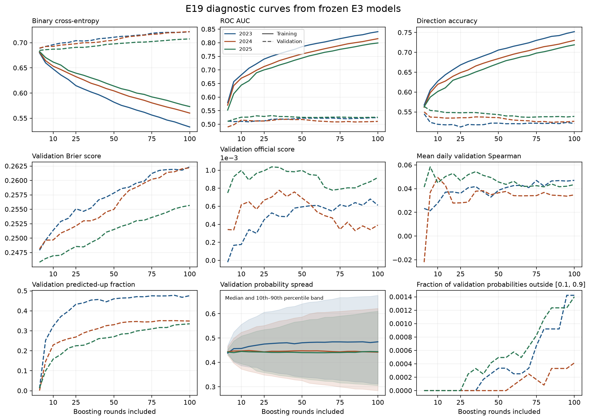
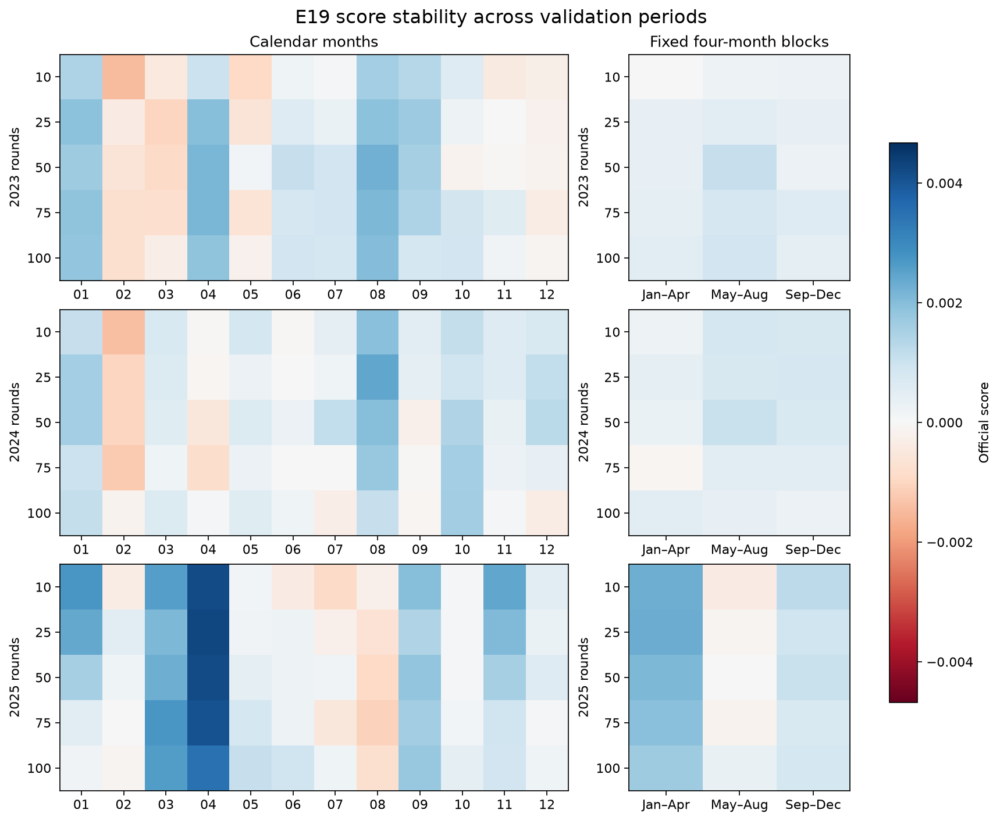

# E19 XGBoost complexity and overfitting investigation

**E3’s later trees fit the training data increasingly well while making validation probabilities worse. The official score tells a more mixed story.** The 50-round prefix scored higher on average than the full model, while the 100-round model had the strongest worst four-month block among the five required checkpoints. Keep E3 as the reference. The results justify one controlled simplification test if work on tree capacity continues.

## What was measured

E19 loaded the three frozen, plain-F0 E3 controls saved during E18 and restored their original fold-fitted preprocessors. Each model contains 100 rounds. The five required percentages map to **10, 25, 50, 75 and 100** rounds under integer half-up rounding. The diagnostic adds round 1 and intermediate multiples of 5, for 21 checkpoints per fold. Each point uses `Booster.predict(iteration_range=(0,k))` on the *same* fitted trees. The prefix length does not refit preprocessing, modify thresholds, or change observations. [XGBoost prediction API](https://xgboost.readthedocs.io/en/stable/python/python_api.html#xgboost.Booster.predict).

The 100-round predictions reproduce archived probabilities to within **3.0 × 10⁻⁸** and reproduce every decision and each official score. The 2023, 2024 and 2025 evaluation sets contain 11,950, 12,099 and 12,140 target-stock rows. Training metrics use the full 100-stock fitting panels. A target-stock-only training sensitivity check also shows a growing AUC gap. Accuracy and call fractions use the original TAIEX rule on both splits. The metrics CSV also includes accuracy at a fixed 0.5 cutoff for context. AUC measures absolute direction, while daily Spearman compares probability ranks against realized intraday return ranks on that date.

## Validation probability and discrimination curves

| Rounds | Train BCE | Validation BCE | Train AUC | Validation AUC | Train accuracy | Validation accuracy | Validation Brier | Mean daily Spearman | Up calls |
| ---: | ---: | ---: | ---: | ---: | ---: | ---: | ---: | ---: | ---: |
| 10 | 0.65426 | 0.69197 | 0.6653 | 0.5175 | 61.62% | 53.57% | 0.24933 | 0.0407 | 23.69% |
| 25 | 0.62893 | 0.69762 | 0.7176 | 0.5178 | 65.14% | 53.18% | 0.25192 | 0.0370 | 30.90% |
| 50 | 0.60010 | 0.70438 | 0.7627 | 0.5221 | 68.75% | 53.36% | 0.25476 | 0.0403 | 35.37% |
| 75 | 0.57639 | 0.71261 | 0.7936 | 0.5189 | 71.27% | 52.81% | 0.25834 | 0.0412 | 37.68% |
| 100 | 0.55532 | 0.71708 | 0.8184 | 0.5203 | 73.38% | 52.87% | 0.26008 | 0.0418 | 38.67% |

Each column averages the three folds equally. In each fold, training BCE falls and validation BCE and Brier rise across the five required checkpoints. Training AUC improves by 0.15–0.16 from 10 to 100 rounds. Validation AUC stays near 0.52, with individual 10-to-100 changes of +0.0136, −0.0048 and −0.0002 in 2023, 2024 and 2025. The in-sample AUC pattern also holds on the Top50 subset, so the stock-universe difference alone cannot explain the gap.

The middle 80% of probabilities widens in every fold. In 2024, the 10th–90th percentile band expands from **0.373–0.524** at 10 rounds to **0.285–0.622** at 100. True tail values remain rare. No validation probability is below 0.1 or above 0.9 at round 10 and at most **0.15%** are outside those bounds at round 100 in any fold. Spearman improves from 0.0279 to 0.0470 in 2023, declines from 0.0494 to 0.0348 in 2024, and changes from 0.0448 to 0.0434 in 2025. Later rounds therefore do not show a consistent improvement or deterioration in within-day ranking.



## Official score and temporal stability

| Rounds | 2023 | 2024 | 2025 | Equal-year score | Worst month | Negative months | Worst four-month block |
| ---: | ---: | ---: | ---: | ---: | ---: | ---: | ---: | ---: |
| 10 | 0.000177 | 0.000617 | 0.000998 | 0.000597 | −0.001484 | 12 | −0.000368 |
| 25 | 0.000450 | 0.000668 | 0.000994 | 0.000704 | −0.001018 | 10 | −0.000137 |
| 50 | 0.000593 | 0.000691 | 0.000998 | 0.000761 | −0.000994 | 9 | −0.000016 |
| 75 | 0.000617 | 0.000344 | 0.000790 | 0.000584 | −0.001224 | 9 | −0.000150 |
| 100 | 0.000611 | 0.000391 | 0.000919 | 0.000640 | −0.000742 | 10 | +0.000287 |

The 50-round prefix beats 100 rounds by about **0.000120** on the equal-year mean. Its gains come from 2024 and 2025. In 2023, 100 rounds narrowly beat 50 and clearly beat the shorter 10- and 25-round prefixes. At 100 rounds, all nine calendar blocks scored positively, and the worst individual month also scored higher than the worst month at any other required checkpoint. Scores peak at different diagnostic rounds by year, and the selected extrema would be optimistic because these are the evaluation years. The smallest validation BCE occurs at round 1 in every fold among the measured checkpoints, while the one-round official mean is only **0.000357**. This follows the pattern seen in E6 and illustrates why log loss and the official signed-return score can favor different decisions.



## Interpretation and one candidate for a later test

The divergence in BCE, Brier and AUC is evidence of **overfitting the absolute-direction probability objective** on these folds. It is less direct evidence about the return-weighted score. Period changes can contribute to the absolute gap between the training and validation panels. E19 measures worsening validation probability error as more trees are included within the same fold, but it does not identify which market or input changes made the later splits less useful. Differing scores across years and cutoffs also reflect how the fixed threshold maps probabilities into positions and how much the realized moves weigh in the score.

The tree audit shows that every tree reaches depth 6. Many leaves have low training-row support, although very few predictions route through those leaves. This is a reason to test structural complexity directly. It does not establish that sparse leaves caused the losses. Shallow, strongly regularized combinations and practically one-tree early stopping have already been tried. [Complexity audit and earlier experiments](E3_complexity_audit.md).

For one follow-up, test **depth 4, minimum child Hessian 10, and L2 5**, with the other E3 settings held fixed. Depth 4 caps a binary tree at 16 leaves instead of 64. Raising the minimum child Hessian from 1 to 10 makes it harder to grow splits with weak support. Raising L2 from 1 to 5 shrinks leaf scores. Keep `eta=0.30`, L1 zero, full sampling, seed 42, and the **original fixed 100-round budget**. This isolates the structural change as one deliberately regularized configuration and avoids choosing a round count on the outer curves. Earlier runs changed these settings alongside learning rate, sampling, or a round-selection procedure. If round selection becomes a separate question, specify an inner chronological procedure before fitting and lock the chosen count before outer evaluation.

One comparison under that design is warranted if the aim is to attribute the probability gap to tree capacity. A new broad search on the same years is unlikely to clarify generalization. Any model replacement would need evaluation on a genuinely unused period. E19 itself ran only inference on saved boosters and prepared no submission.

## Reproduction and saved evidence

Run from `final_project` with a fresh output directory. The completed run used XGBoost 3.4.1, scikit-learn 1.9.1, and Matplotlib 3.11.2.

```powershell
uv run --with scikit-learn==1.9.1 python -m members.zhenci.xgboost.e19.diagnose_e19 --output-dir members/zhenci/xgboost/e19/reproduction
uv run --with matplotlib==3.11.2 python -m members.zhenci.xgboost.e19.plot_e19 --output-dir members/zhenci/xgboost/e19/reproduction
```

[Per-fold checkpoint metrics and probability quantiles](outputs/checkpoint_metrics.csv), [equal-year curves](outputs/equal_year_curves.csv), [five-checkpoint probabilities and decisions](outputs/validation_predictions.csv), [daily scores](outputs/daily_scores.csv), [monthly scores](outputs/monthly_scores.csv), [four-month scores](outputs/four_month_scores.csv), [input hashes](outputs/summary.json).
